<!--
  Este README é gerado por scripts/render_static.py a partir de content/profile.json.
  Para mudar textos, projetos, stack ou links, edite content/profile.json: o GitHub Actions
  regenera este arquivo e os SVGs (os números de contribuição são atualizados todo dia).
-->

 
 

<h3><code>miguel@creativezone ~ $ whoami</code></h3>

<table>
<tr>
<td valign="top"></td>
<td valign="top"></td>
</tr>
</table>

 

<h3><code>miguel@creativezone ~ $ ./contributions.sh</code></h3>

 
 

<h3><code>miguel@creativezone ~ $ ls ~/projetos</code></h3>

<table>
<tr>
<td valign="top"></td>
<td valign="top"></td>
</tr>
<tr>
<td valign="top"></td>
<td valign="top"></td>
</tr>
</table>

 

<h3><code>miguel@creativezone ~ $ cat stack.json</code></h3>

 
 

<h3><code>miguel@creativezone ~ $ cd ~/creative-zone</code></h3>

 
 

<h3><code>miguel@creativezone ~ $ ./snake.sh</code></h3>

 
 

<h3><code>miguel@creativezone ~ $ ./links.sh</code></h3>

 
 

tudo aqui é SVG gerado por código, animado sem JavaScript e atualizado todo dia pelo GitHub Actions

