<!-- ================= 1. CINEMATIC HEADER ================= -->

 

<!-- ================= 2. LIVE SYSTEM TELEMETRY PILLS ================= -->

  
  &nbsp;
  
  &nbsp;
  
  &nbsp;
  

<!-- ================= 3. TYPEWRITER TERMINAL ================= -->

---

<!-- ================= 4. COMMAND CENTER HUD BANNER ================= -->

  

<!-- ================= 5. 3D LANYARD & PRODUCTION STATS ================= -->
<table border="0" width="100%" cellpadding="0" cellspacing="0">
  <tr>
    <td width="42%" align="center" valign="top">
      
    </td>
    <td width="58%" align="center" valign="top">
      
    </td>
  </tr>
</table>

<!-- ================= 6. ANIMATED FULL-STACK & 3D PIPELINE ================= -->

  

<!-- ================= 7. GITHUB CONTRIBUTION SNAKE ================= -->

  

---

## ⚡ Engineering Principles & Digital Products

> *Construindo produtos digitais de ponta a ponta: arquitetura de dados, interfaces web, aplicativos mobile, agentes de IA e automação.*

<table width="100%">
  <tr>
    <td width="33%" valign="top">
      <h4>🎯 Produtos de ponta a ponta</h4>
      Arquitetura de dados, interfaces web e aplicações mobile integradas à operação real dos clientes.
    </td>
    <td width="33%" valign="top">
      <h4>🛡️ Agentes de IA & automação</h4>
      Integração de MCP e automação com computadores, servidores, VPS e ferramentas do dia a dia.
    </td>
    <td width="33%" valign="top">
      <h4>💎 Software & infraestrutura</h4>
      Projetos com React, TypeScript, Supabase, PostgreSQL, Cloudflare, Docker e GitHub Actions.
    </td>
  </tr>
</table>

---

<!-- ================= 8. FLAGSHIP ENGINEERING REPOSITORIES ================= -->

## 🚀 Flagship Engineering Deployments
Projetos reais de software, automação, IA e plataformas digitais.
  

<table border="0" width="100%">
  <tr>
    <td align="center" width="50%" valign="top">
      
        
      <b>🧠 Creative Lovable</b> 
      Ambiente de criação para agentes de IA via MCP — do código ao preview e à validação.
        
      <code>Node.js</code> • <code>MCP SDK</code> • <code>Playwright</code> • <code>Zod</code> • <code>JSZip</code>
        
      
    </td>
    <td align="center" width="50%" valign="top">
      
        
      <b>🌐 CreativeZone</b> 
      Comunidade e plataforma de tecnologia onde conversas evoluem para ideias, projetos e colaboração.
        
      <code>React 19</code> • <code>Vite</code> • <code>Supabase</code> • <code>Cloudflare</code> • <code>Resend</code>
        
      &nbsp;
    </td>
  </tr>
  <tr>
    <td align="center" width="50%" valign="top">
      
        
      <b>📅 Meu Salão</b> 
      Plataforma de gestão para salões de beleza — agenda, equipe, serviços e operação em um só lugar.
        
      <code>TypeScript</code> • <code>TanStack</code> • <code>Supabase</code> • <code>Capacitor</code> • <code>Tailwind</code>
        
      &nbsp;
    </td>
    <td align="center" width="50%" valign="top">
      
        
      <b>🤖 Linkou MCP Remoto</b> 
      Infraestrutura remota para que agentes de IA operem computadores, servidores e VPS com controles de segurança.
        
      <code>TypeScript</code> • <code>MCP SDK</code> • <code>WebSocket</code> • <code>Postgres</code> • <code>Docker</code>
        
      
    </td>
  </tr>
  <tr>
    <td align="center" width="50%" valign="top">
      
        
      <b>✂️ Connect Barber</b> 
      Rede de barbearias com busca por localização, mapas, agendamento e portal do parceiro.
        
      <code>HTML</code> • <code>PHP</code> • <code>JavaScript</code> • <code>Leaflet</code> • <code>JSON</code>
        
      
    </td>
    <td align="center" width="50%" valign="top">
      
        
      <b>💼 Meu Portfólio</b> 
      Portfólio web pessoal desenvolvido com React, Next.js e Styled Components.
        
      <code>React</code> • <code>Next.js</code> • <code>JavaScript</code> • <code>Styled Components</code>
        
      
    </td>
  </tr>
</table>

---

<!-- ================= 9. CLASSIFIED TECH ARSENAL MATRIX ================= -->

## 🛠️ Classified Tech Arsenal Matrix

<table width="100%">
  <tr>
    <td align="center" width="50%" valign="top">
      <h4>🎨 Frontend &amp; Interfaces</h4>
      
        
      React • TypeScript • JavaScript • Vite • TanStack • Tailwind CSS • shadcn/ui • Radix
    </td>
    <td align="center" width="50%" valign="top">
      <h4>⚙️ Backend &amp; APIs</h4>
      
        
      Node.js • Deno • Supabase • PostgreSQL • Zod • Resend • APIs
    </td>
  </tr>
  <tr>
    <td align="center" width="50%" valign="top">
      <h4>🛡️ Infraestrutura &amp; DevOps</h4>
      
        
      Cloudflare • Docker • Caddy • GitHub Actions • pnpm • Linux • Git
    </td>
    <td align="center" width="50%" valign="top">
      <h4>📱 AI, MCP &amp; Mobile</h4>
      
        
      Model Context Protocol (MCP) • Claude • Capacitor • Android • Vitest • Playwright
    </td>
  </tr>
</table>

---

<!-- ================= 10. REAL-TIME TELEMETRY & ACHIEVEMENTS ================= -->

## 📈 Real-Time GitHub Telemetry & Velocity

  
  &nbsp;
  

### 🏆 Verified GitHub Profile Highlights
Dados registrados no GitHub em 07/11/2026. As contagens podem mudar.
  

<table border="0" width="100%">
  <tr>
    <td align="center" width="25%"><h2>11</h2><b>Repositórios</b> Públicos e privados</td>
    <td align="center" width="25%"><h2>107</h2><b>Contribuições</b> Últimos 12 meses</td>
    <td align="center" width="25%"><h2>4</h2><b>Dias ativos</b> Últimos 12 meses</td>
    <td align="center" width="25%"><h2>2</h2><b>Sequência</b> Dias consecutivos</td>
  </tr>
</table>

---

<!-- ================= 11. AUTHENTICATED CONTACT DECK & QR ================= -->

## 📡 Authenticated Comms & Contact Deck

 

  
  &nbsp;
  
  &nbsp;
  
  &nbsp;
  
  &nbsp;
  

 

<table border="0" cellpadding="0" cellspacing="0">
  <tr>
    <td align="center" valign="middle" width="180">
      <b>Scan for my GitHub</b>  
      
    </td>
    <td align="center" valign="middle">
      
    </td>
  </tr>
</table>

  

