<!--
 README gerado por scripts/render_static.py + scripts/render_playbook.py.
 Fonte de textos, projetos e links: content/profile.json.
 As estatísticas continuam sendo atualizadas pelo GitHub Actions.
-->

Retrato em ASCII

<h3>PROJETOS EM DESTAQUE</h3>
<table>
<tr>
<td valign="top"></td>
<td valign="top"></td>
</tr>
<tr>
<td valign="top"></td>
<td valign="top"></td>
</tr>
</table>

<h3>CREATIVE ZONE  /  COMUNIDADE</h3>

<h3>CONTRIBUIÇÕES  /  SNAKE</h3>

tudo aqui é SVG gerado por código, animado sem JavaScript e atualizado todo dia pelo GitHub Actions

